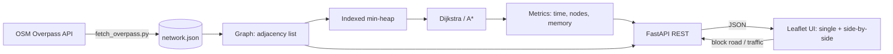

# Visual Route & Transit Optimizer

Interactive Dijkstra vs A* routing on real OpenStreetMap road data, with live road closures,
traffic, and side-by-side search animation. DSA capstone project.

## Run it (one command)
```
powershell -ExecutionPolicy Bypass -File run.ps1      # Windows
bash run.sh                                           # macOS / Linux
```
Then open http://127.0.0.1:8000/compare.html (side by side) or http://127.0.0.1:8000/ (single view).
API docs: http://127.0.0.1:8000/docs

## Architecture


## Project layout
| Path | Purpose |
|---|---|
| `routeopt/` | graph, heap, Dijkstra, A*, costs, metrics, benchmark, service layer |
| `api/main.py` | FastAPI app (also serves `frontend/`) |
| `frontend/` | Leaflet UI: `index.html` (single), `compare.html` (side by side) |
| `scripts/` | data fetch/validate, connectivity check, benchmark, stress test |
| `tests/` | unit tests (`pytest -v`) |
| `docs/` | design notes, admissibility proof, demo script, viva Q&A |

## Setup and checks
```
python -m venv .venv
.venv\Scripts\activate                     # macOS/Linux: source .venv/bin/activate
pip install -r requirements.txt
pytest -v
python scripts/check_connectivity.py data/network.json
python scripts/benchmark.py --pairs 200 --mode distance --out data/benchmark.json
python scripts/stress_test.py --trials 2000
```

## Use your own area
```
python scripts/fetch_overpass.py --bbox SOUTH WEST NORTH EAST --out data/network.json
python scripts/validate_network.py data/network.json
```

## REST API
| Method | Path | Body |
|---|---|---|
| GET | `/api/nodes`, `/api/edges` | - |
| POST | `/api/route` | `{"source":0,"target":99,"algorithm":"both","mode":"distance"}` |
| POST | `/api/edges/congestion` | `{"source":0,"target":1,"multiplier":3}` or `{"closed":true}` |
| POST | `/api/reset` | - |

Complexity: O((V + E) log V). A* uses the admissible, consistent Haversine heuristic (proof in `docs/DAY8_ADMISSIBILITY.md`).
